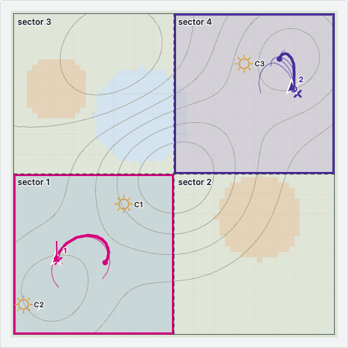
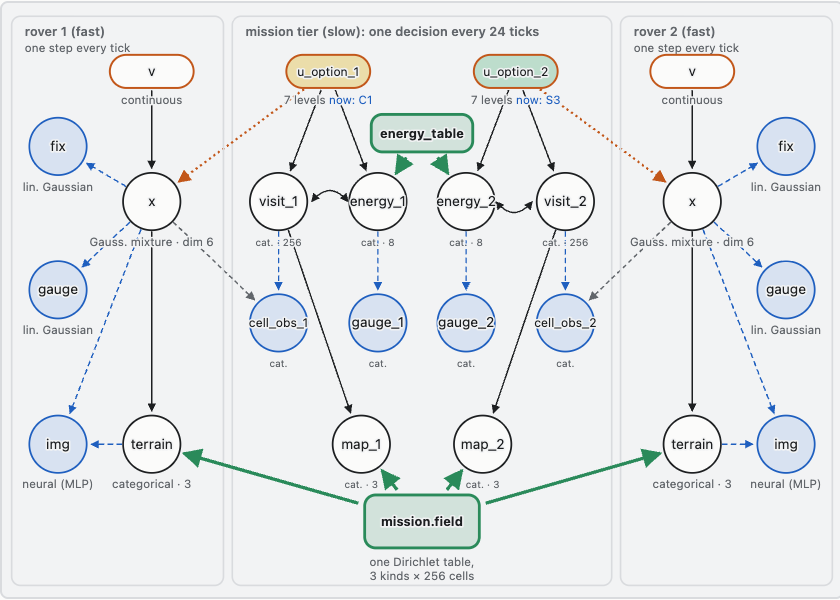

# Hybrid-AIF: <br> Continuous-discrete-amortized active inference

A software package (in active development, and in many respects experimental; see
`docs/capabilities.md`) aimed at production-grade, potentially large-scale implementations of
active inference (AIF): parallel policy search in JAX, vectorised over policies and vmappable
over agents; continuous and discrete observations and state factors, including mixtures and
switching structure; closed-form conjugate updates, fixed-point variational inference for 
discrete factors, and linearised and amortized (neural) inference in the same model; and 
flexibility in specifying models and objective functions.

## Solar rover demo

<p align="center">
  
  
</p>

*Contour map, with each rover's position/heading beliefs, satellite fixes and true path in its
color, and patches colored by the shared map's accumulated certainty about terrain class. A rover's
chosen plan is drawn bold in its color, alternate plans thinner.*

In this demo, two solar-powered rovers build a map of a 2.5D environment (a field with continuously
varying height), classifying terrain into three kinds (firm, rough, and ice). Each rover's battery
charges in sunlight, which depends on which slopes are shaded. For navigation rovers rely on a forward
camera and a GPS-like satellite signal whose quality varies over the field. The demo shows two variants:
one with rovers alone and one a hierarchical model whose second layer is a discrete mission planner
that provides per-rover options to map a given coarse-grained sector, or to charge the battery. 

See the [project page](https://noumenal-labs.github.io/hybrid-aif/) for the full demo, with details
on objective terms, description length, and more. The [demo notebook](examples/demo.ipynb) 
and the [API reference](https://noumenal-labs.github.io/hybrid-aif/api/) are the other two places to start.

Status: see `docs/capabilities.md` (maintained per release) and
`docs/project-brief.md`. Supporting docs in `/docs`:

- `capabilities.md` — per-release capability descriptions, with each release's migration note
- `composing-systems.md` — the main abstraction, `System`, and its fields, the term tree, merging Systems
- `description-format.md` — model description, a versioned JSON document of a model
- `project-brief.md` — design overview
- `scoping-review.md` — vetting of this plan against the reference repos and papers (frozen snapshot)
- `de-risk-report.md` — resolution of the three highest-uncertainty design items (MNLR inference, mixture propagation, model representation)
- `design/system.md`, `design/conditional-families.md` — adopted architecture decisions

## Install

```bash
uv venv && uv pip install -e ".[dev]"   # or: pip install -e ".[dev]"
.venv/bin/python -m pytest              # 3,800+ tests
```

Requires jax>=0.11, equinox>=0.13.8, numpy>=2.0 (older JAX minor versions break
mixture KL paths; the floors are load-bearing).

## Seed ideas

This project aims to extend the discrete active-inference capabilities of libraries like `pymdp` (policy search scored by expected free energy) into the hybrid continuous-discrete (mixture-model) setting, augmented further with amortized (e.g. neural) factors, for things like [R-AIF](https://arxiv.org/abs/2409.14216)-style 
learned preferences or [JEPA](https://arxiv.org/abs/2301.08243)-style latent-space objectives, and generally designed to facilitate slotting flexible AIF models 
into broader ML systems. 

Several further foundational design commitments motivated the creation of a new software package, and it seemed worth a shot to create one given the relative ease of agent-assisted coding these days. One such commitment was to make per-term specification and logging of expected-free-energy-like objectives available (e.g. ablation 
of epistemic terms per-variable). Another was truly flexible model specification: within reasonable limits, any variable, whether it represents a latent state, a 
sensory modality, a control state, or a parameter, should be conditionable on other variables, and should be able to take a homeostatic ("preference") target or 
terminal-state constraint (this is still aspirational in full generality, but control and latent-state targets and terminals exist now). 

The library's design philosophy also adopts the lens that any physical system (including classical "agents" as well as their components and environments) can be 
formalized in terms of appropriately nested or coupled subsystems — this led to the main workhorse/abstraction in the library, the `System`. Each such system can
be translated into a canonical document with an associated description length (model + optional data cost in nats), which might also serve as the basis of AI agent-assisted model search. See `docs/description-format.md` for more detail.

## Use of software agents

Most of this code was written by Claude, through Claude Code under the direction of the maintainers: we set the goals and made the design decisions, and agents proposed, implemented, tested and reviewed (using a Fable agent for most top-level design collaboration). The design records in `docs/design/` show how each decision was reached. This project is in part an exercise in learning how useful research software can be built leveraging coding agents, exploiting the efficiency that they afford without compromising on scientific or academic integrity (the jury is still out on the extent to which this is possible).

## Reference designs

Reference repos made available in `/reference` (note: not committed on remote; clone if needed)

- `pymdp` (JAX): efficient multi-agent policy search in JAX for discrete models. We build on its core structures (Agent-as-pytree, rollout/scan machinery, planner hook) and extend the model-specification layer to continuous and hybrid nodes. [repo](https://github.com/infer-actively/pymdp.git)
- `stable-worldmodel`: reference for the data pipeline (format registry, Lance schema, replay buffer, goal relabeling) and solver protocol layering; not for vectorization. [repo](https://github.com/galilai-group/stable-worldmodel.git)
- `pgmax`: pattern reference for discrete compute kernels (tempered log-space numerics, scan discipline); dense batched einsum is preferred where model shapes are homogeneous. Dormant; reference only. [repo](https://github.com/google-deepmind/PGMax.git)
- `RxInfer`: inspiration for a general-purpose, factor-graph-first implementation [repo](https://github.com/ReactiveBayes/RxInfer.jl)

## Bibliography

- [arXiv:2201.03904](https://arxiv.org/abs/2201.03904) - PyMDP library spec
- [arXiv:2202.04110](https://arxiv.org/abs/2202.04110) - `pgmax` library whitepaper
- [arXiv:2409.14216](https://arxiv.org/abs/2409.14216) - R-AIF: Practical implementation of active inference with continuous variables and learned preferences
- [arXiv:2603.19312](https://arxiv.org/abs/2603.19312) - LeWorldModel: compact JEPA (latent-space-prediction objective) world modeling
- [arXiv:2602.08968](https://arxiv.org/abs/2602.08968) - `stable-worldmodel` reference doc
- [doi:10.1080/17588928.2015.1020053](https://doi.org/10.1080/17588928.2015.1020053) - Classic theory paper on epistemic value in active inference
- [doi:10.3390/e23070807](https://doi.org/10.3390/e23070807) - comprehensive approach to deriving message passing algorithms from constraints on factor graphs
- [doi:10.1162/neco_a_01341](https://doi.org/10.1162/neco_a_01341) - affective inference (contains the $\gamma$ proposal)
- [arXiv:1903.09136](https://arxiv.org/abs/1903.09136) - Gaussian approximations for deterministic non-linear transformations (useful for using arbitrary functions in factor graphs); its forward rule is `NonlinearGaussianTransition`'s unscented option, its backward (smoothing) rule the reference for a continuous smoother
- [arXiv:2607.13612](https://arxiv.org/abs/2607.13612) - SIGReg-as-VFE: interprets the SIGReg regularizer as variational free energy — proves JEPA objectives are exact active-inference free energies iff the anti-collapse regulariser is SIGReg, and identifies the state-epistemic term as the one EFE quantity no JEPA world model computes (theory only; empirical side open)
- [arXiv:2312.07547](https://arxiv.org/abs/2312.07547) - Active Inference and Intentional Behaviour (Friston et al., incl. A. Kiefer): the probabilistic grounding of terminal/intended-state priors — `h` as a prior over final states, reciprocal to `d`; capital-`H` as the derived inductive policy prior (backward reachability through a precision-thresholded `B`, `P(u) = σ(−G − H)`); explicitly charters conditioning `h` on a supraordinate hierarchical level and learning it via Dirichlet counts — the design basis for `H_deps` target emission in nesting (see `docs/design/nesting-systems.md` addendum)
- [doi:10.1038/s41467-024-49711-1](https://doi.org/10.1038/s41467-024-49711-1) - Maximum occupancy principle (Ramírez-Ruiz et al., *Nat Commun* 2024): behaviour as maximization of discounted future action-state *path entropy*, `V(s) = E[Σ γ^t (α H(A|s_t) + β H(S'|s_t,a_t))]`, with the axiomatic result that weighted path entropy is the only occupancy measure consistent with per-step additivity, positivity and smoothness; positions itself against FEP and empowerment (both argued to collapse toward deterministic policies). Its `β` term is the `occupancy` row of our term lattice — and is exactly R-AIF's sign-flipped state-entropy term `wment` (see `docs/design/objective-terms.md`)

- [arXiv:2006.04120](https://arxiv.org/abs/2006.04120) - Sophisticated Inference (Friston, Da Costa, Hafner, Hesp & Parr; *Neural Computation* 33(3):713–763, 2021; doi:10.1162/neco_a_01351): planning as a recursion over what the agent will *observe* — the value of an action is its own expected free energy plus the expectation, over the outcomes it may produce, of the softmax-weighted value of the next decision — so information is worth what it lets the agent do next, not only what it reduces. The `"sophisticated"` planner (`planning/sophisticated.py`, over `System.branch_on` modalities) is this recursion, exact and unpruned; the paper's belief-based pruning and pymdp's budgeted tree are the road on from it
- [doi:10.1016/j.biopsycho.2024.108891](https://doi.org/10.1016/j.biopsycho.2024.108891) - Supervised structure learning (Friston, Da Costa, Tschantz, Kiefer, Salvatori, Neacsu, Koudahl, Heins, Sajid, Markovic, Parr, Verbelen & Buckley; *Biological Psychology* 193:108891, 2024): structure learning of discrete generative models by Bayesian model selection under expected-free-energy priors, in a POMDP generalised with *paths* as latent variables — a control variable read as "a path that may or may not be controllable", and a policy as "a combination of paths". The grounding of `docs/design/control-states.md` (control states as ordinary nodes; path dynamics as a control node's transition prior)
- [arXiv:2505.24784](https://arxiv.org/abs/2505.24784) (not in `/papers`; the PDF is 36 MB) - AXIOM (Heins, Van de Maele, Tschantz et al., VERSES, 2025): object-centric world models that grow — every module a conjugate mixture whose components are added when a datum is explained by none of them better than by an empty one (Algorithm 1) and merged by Bayesian model reduction when the merged model's evidence is no lower (Algorithm 2); planning by sampled policies under utility and Dirichlet-parameter information gain. The source of `docs/design/structure-learning.md`: its growth and merge rules are stated there for any categorical factor with conjugate emissions, its recurrent mixture is the customer for a modality that reads a previous-tick belief (`System.lagged`, generalised by `docs/design/nesting-and-coupling.md` N3), and its pixel layer is a separate roadmap row. Academic-license code, not read; ideas only
- [arXiv:2212.01508](https://arxiv.org/abs/2212.01508) - Space is a latent sequence (Raju, Guntupalli, Zhou, Lázaro-Gredilla & George, 2022): clone-structured cognitive graphs — a discrete state cloned so that the same observation can mean different places in a sequence, learned by Baum–Welch and read out by Viterbi over the clone graph — as a unified account of hippocampal representations. On the roadmap after structure learning: a clone is a level, and the tools are the sequence-learning pair over it

Additional key references (Pólya-Gamma, mixture reduction, entropy bounds, hybrid-AIF prior art) are collected at the end of `docs/de-risk-report.md`.

## Acknowledgements

hybrid-aif's discrete engine owes its design to [pymdp](https://github.com/infer-actively/pymdp) (Heins, Millidge, Demekas, Klein, Friston, Couzin & Tschantz, *JOSS* 7(73):4098, 2022, doi:10.21105/joss.04098), and especially to its JAX rewrite by Conor Heins, Alexander Tschantz, Tim Verbelen, Dimitrije Markovic and the contributors listed in its README. pymdp is MIT-licensed, © 2019 Conor Heins and Alec Tschantz. Several pieces are adapted from it directly: the exact Dirichlet novelty weights (`maths._exact_wnorm`), the factorised fixed-point iteration (`algos.run_factorized_fpi`), policy enumeration (`control.construct_policies`) and the classic T-maze tensors (`envs.TMaze`). Others are reimplemented from its specification with pymdp's own functions as our parity oracle: expected states and observations, utility, state information gain and the A/B parameter information gain (`control.py`); the policy posterior, action marginals and action and policy sampling with its `alpha` precision; and the Dirichlet count updates (`learning.py`). We also took its architecture: the agent as a pytree with static configuration and vmapped agents, `A_dependencies`/`B_dependencies` wiring and the A/B/C/D/E roles, the `infer_states`/`infer_policies`/`update_empirical_prior` faces, the scan-over-horizon and vmap-over-policies evaluation, the functional `Env`, and the masked fixed-window rollout history. We are grateful to its authors for building it, by hand and in the open.

Much of that design, and pymdp's, descends from the active-inference routines of [SPM](https://www.fil.ion.ucl.ac.uk/spm/) (Statistical Parametric Mapping; Tierney et al., *SPM 25: open source neuroimaging analysis software*, *JOSS* 10(110):8103, 2025, doi:10.21105/joss.08103), written chiefly by Karl Friston in its DEM toolbox. We follow its `spm_MDP_VB_X`, `spm_MDP_VB_XX` and `spm_MDP_VB_XXX` for the exact Dirichlet novelty weights (`spm_wnorm`) and their masked, product-of-marginals average, the risk-plus-ambiguity form of expected free energy, the `alpha`-sharpened action marginal, the sophisticated recursion (`spm_forwards`) and priors over final states (`H`), and its `spm_MDP_VB_sleep` and `spm_MDP_log_evidence` for the idea of Bayesian model reduction over Dirichlet counts.
